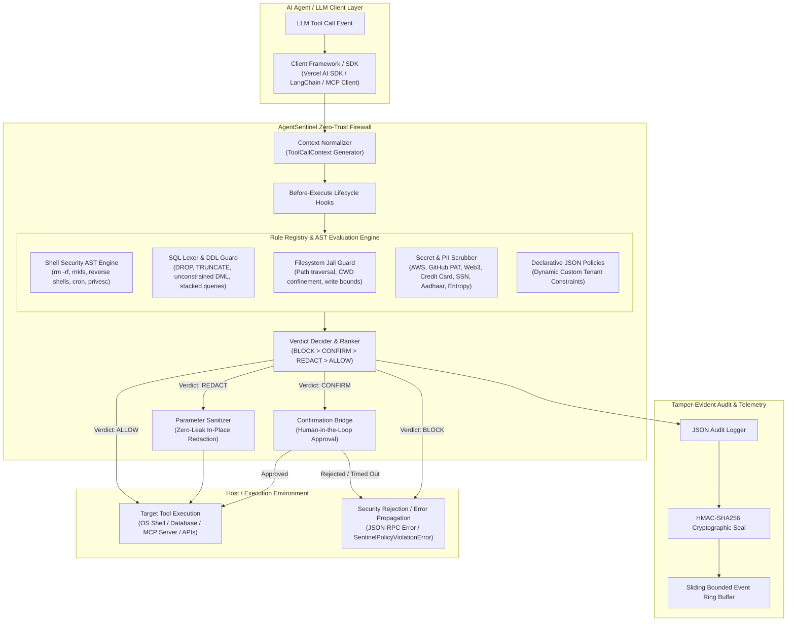

# AgentSentinel System Architecture & Technical Specification

AgentSentinel is a universal, zero-trust runtime security firewall and AST policy interceptor engineered for autonomous AI agents, Model Context Protocol (MCP) tool servers, and enterprise multi-agent workflows.

---

## 1. High-Level System Architecture

---

## 2. Core Execution Lifecycle

Every tool call dispatched to AgentSentinel flows through a deterministic, strictly ordered 8-step lifecycle:

1. **Context Normalization:** Incoming tool invocations (from raw strings, CLI parameters, Vercel AI SDK callbacks, LangChain `_call`, or MCP `tools/call`) are normalized into an immutable `ToolCallContext` record containing `id`, `agentId`, `toolName`, `category`, `params`, and high-resolution `timestamp`.
2. **Pre-Execution Hooks (`beforeExecute`):** Registered lifecycle hooks inspect or inject tracing metadata into the context prior to rule evaluation.
3. **Priority-Ranked Rule Execution:** All active rules in the `RuleRegistry` are executed in descending priority order (higher priority evaluated earlier). Evaluation short-circuits immediately when a `Verdict.BLOCK` is returned.
4. **Verdict Arbitration:** If multiple non-blocking rules trigger, the verdict ranker arbitrates using strict security precedence:
   $$\text{BLOCK} > \text{CONFIRM} > \text{REDACT} > \text{ALLOW}$$
5. **Human-in-the-Loop Confirmation:** If `Verdict.CONFIRM` is determined, the `ConfirmationBridge` publishes a `ConfirmRequestSummary` and awaits an interactive decision from a human operator or fails safe to `BLOCK` upon timeout.
6. **Parameter Redaction:** If `Verdict.REDACT` is determined, secrets and PII matching regex or entropy thresholds are masked using in-place parameter substitution before reaching the underlying execution handler.
7. **Tamper-Evident Audit Logging:** Every evaluation produces a structured `AuditEvent` signed with an HMAC-SHA256 cryptographic seal and stored in a fixed-capacity bounded ring buffer (`SlidingEventQueue`).
8. **Post-Execution Hooks (`afterExecute` / `onViolation`):** Notifications and metrics are dispatched asynchronously to external observability sinks.

---

## 3. Subsystem Architecture

### 3.1. Shell Security AST Engine (`src/shell/`)
- **POSIX Command Tokenizer (`tokenizer.ts`):** Parses raw command lines into discrete pipeline stages, extracting binaries, flags, arguments, redirects, and nested subshells (`$(...)`, `` `...` ``).
- **Destructive Deletion Blocker (`destructive.ts`):** Detects recursive root/home deletion patterns (`rm -rf /`, `rmdir /s`, `shred`) and wildcard-expanded target paths.
- **Disk Format Wipe Guard (`diskwipe.ts`):** Blocks low-level filesystem creation (`mkfs`, `fdisk`, `parted`, `wipefs`) and raw block device writes (`dd of=/dev/sd*`).
- **Fork Bomb & Obfuscation Guard (`forkbomb.ts`):** Catches recursive function fork bombs (`:(){ :|:& };:`) and Base64-encoded shell strings (`base64exec.ts`).
- **Network Exfiltration & Reverse Shells (`reverseshell.ts`, `curlpipe.ts`):** Blocks remote shell attachments (`nc -e /bin/bash`, `/dev/tcp/*`) and piped remote scripts (`curl ... | sh`).

### 3.2. SQL Guard & Query Classifier (`src/sql/`)
- **SQL Grammar Lexer (`tokenizer.ts`):** Strips comments (`--`, `/* ... */`, `#`) and extracts statement tokens.
- **Destructive DDL Guard (`destructive_ddl.ts`):** Intercepts `DROP TABLE`, `DROP DATABASE`, `DROP VIEW`, and `DROP SCHEMA`.
- **Table Truncate Guard (`truncate_blocker.ts`):** Prevents mass table truncation across PostgreSQL, MySQL, SQLite, and Oracle dialects.
- **Unconstrained DML Guard (`unconstrained_delete.ts`, `unconstrained_update.ts`):** Detects missing `WHERE` clauses and tautological WHERE filters (`WHERE 1=1`, `WHERE 'a'='a'`).
- **Stacked Query Guard (`stacked_query.ts`):** Blocks semicolon-delimited multi-statement injection attempts.

### 3.3. Filesystem Confinement (`src/fs/`)
- **Path Traversal Guard (`path_traversal.ts`):** Resolves canonical paths, blocking encoded directory escapes (`%2e%2e`, `..`, null-byte injections).
- **Workspace Jail (`workspace_jail.ts`):** Enforces strict filesystem sandbox boundaries, preventing access outside configured repository roots.
- **Sensitive Directory Blocker (`sensitive_directory_blocker.ts`):** Protects operating system credential stores (`/etc/shadow`, `/etc/sudoers`, `~/.ssh`, `~/.aws`, `C:\Windows\System32\config\SAM`).
- **Resource Limits (`write_size_limiter.ts`, `batch_delete_limiter.ts`):** Restricts oversized file write buffers and mass deletion operations.

### 3.4. Secret & PII Privacy Guard (`src/secrets/`)
- **High-Entropy Scanner (`shannon_entropy.ts`):** Computes exact Shannon entropy $H(X)$ to detect high-entropy API keys and cryptographic secrets.
- **Credential Detectors:** Specialized token scrubbers for AWS SigV4/IAM (`aws_key_detector.ts`), GitHub fine-grained PATs (`github_token_scrubber.ts`), PEM private keys (`pem_key_detector.ts`), and Web3 private keys (`web3_key_scrubber.ts`).
- **PII Scrubbers:** Credit Card PAN Luhn validation (`credit_card_scrubber.ts`), US SSN, Indian Aadhaar Verhoeff checksum (`pii_scrubber.ts`), and configurable email/phone masks (`email_phone_mask.ts`).
- **Enterprise Custom Regex Registry (`enterprise_token_registry.ts`):** Allows enterprises to dynamically register proprietary internal token schemas and redaction functions.
- **Zero-Telemetry Sandbox (`zero_telemetry.ts`):** Enforces strict offline client-side privacy, guaranteeing zero external network transmissions during evaluation.

### 3.5. Protocol & SDK Integration Adapters (`src/mcp/`, `src/sdk/`)
- **MCP Middleware (`src/mcp/interceptor.ts`):** Intercepts MCP JSON-RPC 2.0 `tools/call` and resource reads, returning compliant MCP error results or JSON-RPC errors.
- **MCP Resource Inspector (`src/mcp/resource_inspector.ts`):** Validates `resources/read` URIs against forbidden `file://` schemes, directory traversal, and private IP/cloud metadata SSRF.
- **Vercel AI SDK Adapter (`src/sdk/vercel_ai_adapter.ts`):** Seamless wrapper for Vercel AI SDK `tool.execute()` callbacks.
- **LangChain Adapter (`src/sdk/langchain_adapter.ts`):** Wraps LangChain `StructuredTool` instances, providing `LangChainPolicyException` error propagation and `returnDirectOnError` support.

---

## 4. Security Guarantees & Invariants

1. **Zero-Trust Default:** Every operation is subject to policy verification; tools without explicit rules default to system policy configurations.
2. **Fail-Closed Principle:** If an internal policy evaluation encounters an unhandled exception, it fails closed to `Verdict.BLOCK`.
3. **Immutability of Audit Trails:** Signed audit events cannot be modified or truncated without invalidating the cryptographic HMAC-SHA256 seal.
4. **Air-Gapped Operation:** All AST parsing, regex evaluation, and entropy calculations execute 100% locally in-memory without third-party cloud API dependencies.
